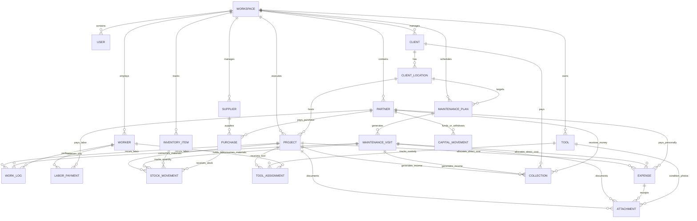

# 📊 Modelo de Datos Objetivo (V2)
## Decolumax / Field Operations & CMMS Core

---

## 1. Diagrama Entidad-Relación Consolidado (Mermaid ERD)

---

## 2. Diccionario de Datos Completo (Tablas Relacionales)

### 2.1 Módulo Base & Identidades
#### `users` (Usuarios del Sistema)
- `id` (UUID, PK, Auto)
- `workspace_id` (UUID, Not Null, Index)
- `email` (TEXT, Not Null, Unique)
- `display_name` (TEXT, Not Null)
- `role` (TEXT, Not Null, Default 'owner')
- `avatar_color` (INTEGER, Not Null, Default 0xFFF59E0B)
- `is_active` (BOOLEAN, Not Null, Default true)
- `created_at`, `updated_at`, `version`, `deleted_at`

#### `partners` (Socios Propietarios e Inversionistas)
- `id` (UUID, PK, Auto)
- `user_id` (UUID, Nullable, FK `users.id`)
- `name` (TEXT, Not Null)
- `phone` (TEXT, Nullable)
- `equity_percentage` (DECIMAL, Not Null, Default 50.0)
- `avatar_color` (INTEGER, Not Null, Default 0xFFF59E0B)
- `is_active` (BOOLEAN, Not Null, Default true)
- `created_at`, `updated_at`, `version`, `deleted_at`

#### `workers` (Trabajadores de Cuadrilla - Sin Login)
- `id` (UUID, PK, Auto)
- `workspace_id` (TEXT, Not Null, Default 'default')
- `name` (TEXT, Not Null)
- `phone` (TEXT, Nullable)
- `specialty` (TEXT, Nullable)
- `default_payment_type` (TEXT, Not Null, Default 'daily')
- `default_rate_cents` (INTEGER, Not Null, Default 0)
- `is_active` (BOOLEAN, Not Null, Default true)
- `notes` (TEXT, Nullable)
- `created_at`, `updated_at`, `created_by`, `updated_by`, `version`, `deleted_at`

---

### 2.2 Clientes y Ubicaciones
#### `clients` (Clientes)
- `id` (UUID, PK, Auto)
- `name` (TEXT, Not Null)
- `contact_person` (TEXT, Nullable)
- `phone` (TEXT, Nullable)
- `email` (TEXT, Nullable)
- `tax_id` (TEXT, Nullable)
- `notes` (TEXT, Nullable)
- `created_at`, `updated_at`, `version`, `deleted_at`

#### `client_locations` (Sedes / Predios del Cliente)
- `id` (UUID, PK, Auto)
- `client_id` (UUID, Not Null, FK `clients.id`, Index)
- `name` (TEXT, Not Null, Default 'Principal')
- `address` (TEXT, Not Null)
- `district` (TEXT, Nullable)
- `reference` (TEXT, Nullable)
- `latitude`, `longitude` (DECIMAL, Nullable)
- `created_at`, `updated_at`, `version`, `deleted_at`

---

### 2.3 Obras y Mantenimientos
#### `projects` (Obras y Proyectos)
- `id` (UUID, PK, Auto)
- `code` (TEXT, Nullable, Index)
- `name` (TEXT, Not Null)
- `client_id` (UUID, Not Null, FK `clients.id`, Index)
- `location_id` (UUID, Nullable, FK `client_locations.id`)
- `description` (TEXT, Nullable)
- `budget_amount` (DECIMAL, Not Null, Default 0.0)
- `start_date` (DATE, Not Null, Index)
- `target_end_date`, `actual_end_date` (DATE, Nullable)
- `status` (TEXT, Not Null, Default 'in_progress', Index)
- `created_at`, `updated_at`, `version`, `deleted_at`

#### `maintenance_plans` (Planes Recurrentes)
- `id` (UUID, PK, Auto)
- `title` (TEXT, Not Null)
- `client_id` (UUID, Not Null, FK `clients.id`, Index)
- `location_id` (UUID, Nullable, FK `client_locations.id`)
- `frequency_type` (TEXT, Not Null, Default 'monthly')
- `interval_days` (INTEGER, Not Null, Default 30)
- `estimated_cost` (DECIMAL, Not Null, Default 0.0)
- `is_active` (BOOLEAN, Not Null, Default true, Index)
- `created_at`, `updated_at`, `version`, `deleted_at`

#### `maintenance_visits` (Historial de Visitas Reales)
- `id` (UUID, PK, Auto)
- `plan_id` (UUID, Not Null, FK `maintenance_plans.id`, Index)
- `scheduled_date` (DATE, Not Null, Index)
- `completed_date` (DATETIME, Nullable)
- `status` (TEXT, Not Null, Default 'scheduled', Index)
- `technician_notes` (TEXT, Nullable)
- `created_at`, `updated_at`, `version`, `deleted_at`

---

### 2.4 Inventario y Herramientas
#### `inventory_items` (Consumibles / Insumos)
- `id` (UUID, PK, Auto)
- `sku` (TEXT, Nullable, Index)
- `name` (TEXT, Not Null)
- `category` (TEXT, Not Null, Default 'plants', Index)
- `unit` (TEXT, Not Null, Default 'unit')
- `min_stock_alert` (DECIMAL, Not Null, Default 0.0)
- `default_cost` (DECIMAL, Not Null, Default 0.0)
- `is_active` (BOOLEAN, Not Null, Default true)
- `created_at`, `updated_at`, `version`, `deleted_at`

#### `stock_movements` (Ledger Inmutable de Stock)
- `id` (UUID, PK, Auto)
- `item_id` (UUID, Not Null, FK `inventory_items.id`, Index)
- `movement_type` (TEXT, Not Null, Default 'consumption', Index)
- `quantity` (DECIMAL, Not Null)
- `unit_cost` (DECIMAL, Not Null, Default 0.0)
- `project_id` (UUID, Nullable, FK `projects.id`, Index)
- `visit_id` (UUID, Nullable, FK `maintenance_visits.id`, Index)
- `purchase_id` (UUID, Nullable, FK `purchases.id`, Index)
- `date` (DATETIME, Not Null, Index)
- `notes` (TEXT, Nullable)
- `created_at`, `updated_at`, `version`, `deleted_at`

#### `tools` (Herramientas y Activos)
- `id` (UUID, PK, Auto)
- `code` (TEXT, Nullable, Index)
- `name` (TEXT, Not Null)
- `brand_model` (TEXT, Nullable)
- `serial_number` (TEXT, Nullable)
- `purchase_date` (DATE, Nullable)
- `purchase_price` (DECIMAL, Not Null, Default 0.0)
- `current_status` (TEXT, Not Null, Default 'available', Index)
- `condition` (TEXT, Not Null, Default 'good')
- `created_at`, `updated_at`, `version`, `deleted_at`

#### `tool_assignments` (Historial de Custodia)
- `id` (UUID, PK, Auto)
- `tool_id` (UUID, Not Null, FK `tools.id`, Index)
- `worker_id` (UUID, Nullable, FK `workers.id`, Index)
- `project_id` (UUID, Nullable, FK `projects.id`, Index)
- `assigned_at` (DATETIME, Not Null, Index)
- `returned_at` (DATETIME, Nullable, Index)
- `condition_out` (TEXT, Not Null, Default 'good')
- `condition_in` (TEXT, Nullable)
- `notes` (TEXT, Nullable)
- `created_at`, `updated_at`, `version`, `deleted_at`

---

### 2.5 Jornadas, Gastos y Finanzas
#### `work_logs` (Jornadas Laboradas)
- `id` (UUID, PK, Auto)
- `workspace_id` (TEXT, Not Null, Default 'default')
- `worker_id` (UUID, Not Null, FK `workers.id`, Index)
- `date` (DATE/DATETIME, Not Null, Index)
- `project_id` (UUID, Nullable, FK `projects.id`, Index)
- `maintenance_visit_id` (UUID, Nullable, FK `maintenance_visits.id`, Index)
- `payment_type` (TEXT, Not Null, Default 'daily')
- `quantity` (REAL / Decimal controlado a 2 dec, Not Null, Default 1.0)
- `rate_cents` (INTEGER, Not Null, Default 0)
- `amount_cents` (INTEGER, Not Null, Default 0)
- `notes` (TEXT, Nullable)
- `created_at`, `updated_at`, `created_by`, `updated_by`, `version`, `deleted_at`
- *Constraints*: `CHECK ((project_id IS NOT NULL AND maintenance_visit_id IS NULL) OR (project_id IS NULL AND maintenance_visit_id IS NOT NULL))`, `CHECK (quantity > 0 AND rate_cents >= 0 AND amount_cents >= 0)`

#### `labor_payments` (Pagos a Trabajadores)
- `id` (UUID, PK, Auto)
- `worker_id` (UUID, Not Null, FK `workers.id`, Index)
- `amount` (DECIMAL, Not Null)
- `date` (DATE, Not Null, Index)
- `paid_by_partner_id` (UUID, Not Null, FK `partners.id`, Index)
- `notes` (TEXT, Nullable)
- `created_at`, `updated_at`, `version`, `deleted_at`

#### `expenses` (Gastos Operativos Directos)
- `id` (UUID, PK, Auto)
- `concept` (TEXT, Not Null)
- `category` (TEXT, Not Null, Default 'fuel', Index)
- `amount` (DECIMAL, Not Null, Default 0.0)
- `date` (DATETIME, Not Null, Index)
- `paid_by_partner_id` (UUID, Not Null, FK `partners.id`, Index)
- `project_id` (UUID, Nullable, FK `projects.id`, Index)
- `visit_id` (UUID, Nullable, FK `maintenance_visits.id`, Index)
- `split_mode` (TEXT, Not Null, Default 'equal')
- `split_ratios_json` (TEXT, Not Null, Default '{}')
- `notes` (TEXT, Nullable)
- `created_at`, `updated_at`, `version`, `deleted_at`

#### `capital_movements` (Aportes y Retiros de Capital)
- `id` (UUID, PK, Auto)
- `partner_id` (UUID, Not Null, FK `partners.id`, Index)
- `type` (TEXT, Not Null, Default 'investment', Index)
- `amount` (DECIMAL, Not Null, Default 0.0)
- `date` (DATE, Not Null, Index)
- `notes` (TEXT, Nullable)
- `created_at`, `updated_at`, `version`, `deleted_at`

#### `collections` (Cobros a Clientes)
- `id` (UUID, PK, Auto)
- `client_id` (UUID, Not Null, FK `clients.id`, Index)
- `project_id` (UUID, Nullable, FK `projects.id`, Index)
- `visit_id` (UUID, Nullable, FK `maintenance_visits.id`, Index)
- `amount` (DECIMAL, Not Null, Default 0.0)
- `date` (DATE, Not Null, Index)
- `received_by_partner_id` (UUID, Not Null, FK `partners.id`, Index)
- `payment_method` (TEXT, Not Null, Default 'cash')
- `notes` (TEXT, Nullable)
- `created_at`, `updated_at`, `version`, `deleted_at`

#### `suppliers` (Proveedores)
- `id` (UUID, PK, Auto)
- `name` (TEXT, Not Null)
- `phone` (TEXT, Nullable)
- `tax_id` (TEXT, Nullable)
- `address` (TEXT, Nullable)
- `notes` (TEXT, Nullable)
- `created_at`, `updated_at`, `version`, `deleted_at`

#### `purchases` (Compras de Insumos/Inventario)
- `id` (UUID, PK, Auto)
- `supplier_id` (UUID, Nullable, FK `suppliers.id`, Index)
- `paid_by_partner_id` (UUID, Not Null, FK `partners.id`, Index)
- `total_amount` (DECIMAL, Not Null)
- `date` (DATE, Not Null, Index)
- `invoice_number` (TEXT, Nullable)
- `created_at`, `updated_at`, `version`, `deleted_at`

---

### 2.6 Adjuntos y Sincronización
#### `attachments` (Evidencias y Comprobantes)
- `id` (UUID, PK, Auto)
- `parent_type` (TEXT, Not Null, Index)
- `parent_id` (UUID, Not Null, Index)
- `stage` (TEXT, Nullable)
- `local_file_path` (TEXT, Not Null)
- `file_name` (TEXT, Not Null)
- `file_size_bytes` (INTEGER, Not Null, Default 0)
- `created_at`, `version`, `deleted_at`

#### `sync_queue` (Cola Outbox)
- `id` (INTEGER, PK, Auto-Increment)
- `entity_table` (TEXT, Not Null, Index)
- `entity_id` (UUID, Not Null, Index)
- `operation` (TEXT, Not Null)
- `payload_json` (TEXT, Not Null)
- `queued_at` (DATETIME, Not Null, Index)
- `attempts` (INTEGER, Not Null, Default 0)
