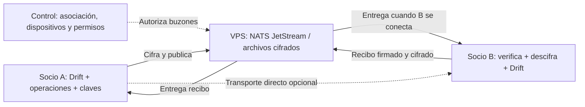

# Migración de Decolumax a sincronización entre socios con cifrado de extremo a extremo

Fecha de diseño: 2026-10-05, America/Lima. Estado al 2026-10-07: relay NATS y recepción local implementados parcialmente; falta cifrado de extremo a extremo y despliegue HTTP de la API.

## 1. Objetivo y decisiones de diseño

Dos socios de la misma organización/workspace, asociados y aceptados, intercambian cambios de negocio. Cada instalación conserva su base Flutter/Drift. Se estudian dos transportes sobre el mismo protocolo:

- **P2P directo:** los dispositivos intercambian datos cuando pueden conectarse simultáneamente.
- **Buzón cifrado en VPS:** un servicio conserva paquetes cifrados hasta que el destinatario se conecte. Esta variante responde a la última petición del usuario y es la recomendación para comenzar.

El buzón es almacenamiento y reenvío, no una conexión directa. El objetivo «sin DB» se interpreta como **sin PostgreSQL ni otro servidor de base de datos para transportar cambios**. Sobrevivir a reinicios requiere archivos persistentes e índices internos. El servicio seguirá almacenando datos cifrados y metadatos de entrega.

Recomendación de diseño: NATS JetStream con almacenamiento `file`, un volumen persistente y clientes Flutter. P2P directo se añade posteriormente como transporte opcional para adjuntos o comunicación local. La elección definitiva depende del piloto de persistencia, autorización, compatibilidad Flutter y memoria. Comparación de proyectos y optimizaciones: [evaluacion-p2p-flutter.md](evaluacion-p2p-flutter.md).

El plan central anterior en [PLAN.md](../PLAN.md) y [sync_protocol_v3.md](../../../docs/sync_protocol_v3.md) describe otro modelo. Sus garantías de orden y validación central no se heredan al cambiar el transporte. No se ha cambiado el Compose operativo ni se han eliminado datos o migraciones.

## 2. Estado comprobado del código

| Componente | Estado observado | Trabajo necesario |
|---|---|---|
| Cliente | Drift, schema 6, outbox y recepción durable de sobres cifrados por workspace | Cifrar outbox, acordar claves, descifrar y aplicar cambios de negocio |
| Outbox | `SyncQueueRepository.enqueue/pending`, `operationId`, `baseVersion`; llamadas en mantenimiento | Cubrir todas las escrituras; añadir registro duradero de operaciones y recibos por dispositivo |
| Compras | Compra, detalles y stock se escriben en transacción | Emitir un único agregado lógico con IDs estables; no recrear movimientos al recibir |
| API NestJS | Auth, sesiones, `POST /sync/push`, `GET /sync/pull`, relay NATS sobre TLS; credenciales solo del servidor | Desplegar por HTTPS/NPM; implementar asociación aceptada, concesiones y revocación de dispositivos |
| Guard de acceso | Verifica JWT, sin consulta de revocación de sesión por petición | Corregir antes de emitir permisos de mensajería; probar refresh concurrente y revocación |
| Protocolo V3 | `server_seq`, OCC y validación central siguen separados del relay nuevo | Definir la transición por workspace sin ejecutar dos autoridades de escritura |
| Android | Manifest principal sin permiso explícito INTERNET; release firmado con debug | Revisar manifest fusionado, permisos por transporte y firma de distribución |
| Bibliotecas P2P | No hay dependencia de WebRTC/NATS/Nearby en `pubspec.yaml` | Prototipo aislado antes de añadir una dependencia al producto |

Los cambios locales previos de navegación, dependencias y documentación del usuario quedan fuera de los commits de este diseño. No hay benchmark de esta arquitectura: las mediciones anteriores de API+PostgreSQL no se pueden presentar como consumo del buzón.

## Avance implementado el 2026-10-07

- `29acd9d feat(sync): add encrypted JetStream inbox API and Flutter client`: endpoints autenticados de push/pull, límites de payload, publicación deduplicada y descarga filtrada por workspace; Flutter guarda inbox y cursor en una transacción Drift.
- `70bde23 chore(deploy): expose sync API to NPM network`: Compose conecta la API a `main_npm_network` por el alias `decolumax-sync-api`, sin publicar el puerto HTTP en el host.
- Validación local: `flutter analyze --fatal-infos`, 210 pruebas Flutter, `npm run build`, 2 pruebas Jest y compilación APK/Web.
- El avance no está desplegado ni verificado contra el VPS. La app no marca eventos como aplicados, porque aún faltan acuerdo de claves entre socios, cifrado de la outbox y aplicación idempotente a las tablas de negocio.

## 3. Arquitectura y límites de confianza

- **Datos locales:** negocio, historial de operaciones, conflictos, adjuntos y claves privadas permanecen en los dispositivos.
- **Buzón:** contenido cifrado, identificadores opacos de destinatario, tamaños, tiempos y estado de entrega. El cifrado no oculta esos metadatos.
- **Control:** organización, miembros aceptados, dispositivos, claves públicas, permisos y revocaciones. Nunca claves privadas de descifrado ni payloads de negocio.
- **Infraestructura mínima:** un broker puede operar solo con usuarios/permisos provisionados por un administrador. JetStream incorpora la persistencia en el propio servidor. [NATS](https://docs.nats.io/concepts/jetstream).
- **Altas desde la app:** invitar, aceptar, registrar dispositivos y revocar automáticamente exige lógica de control. Para aprovechar lo construido, se puede mantener una API pequeña; la alternativa de SQLite embebido eliminaría el contenedor PostgreSQL, pero requiere migración y sigue siendo una DB local de metadatos. Un solo broker no implementa ese flujo de producto.

No empaquetar arbitrariamente API y broker en un contenedor para aparentar menor consumo. El número de imágenes no determina la memoria total. La fase inicial mantiene autenticación existente mientras se demuestra la alternativa; no retirar PostgreSQL antes de migrar usuarios y sesiones.

## 4. Asociación, dispositivos y permisos

La pertenencia al mismo workspace es condición necesaria, junto con una invitación aceptada. Crear un socio contable en `partners` no le concede acceso. `partnerId`, `userId` y `deviceId` tienen responsabilidades distintas.

1. Un propietario invita a una cuenta identificada. Invitación de un uso, con expiración y destino concreto.
2. El invitado autenticado acepta. La autoridad valida que ambos pertenecen al workspace y activa la relación.
3. Cada instalación genera sus claves, demuestra posesión y recibe identidad de dispositivo aprobada.
4. Se muestra verificación de huella/QR por un canal independiente antes de intercambiar claves de datos. El servidor de control no debe poder sustituir claves silenciosamente.
5. Se crean buzones y permisos exclusivamente para esa relación y esos dispositivos. Ningún cliente obtiene permisos de administración global del broker.
6. Revocar bloquea publicación/lectura futura, desconecta sesiones cuando el sistema lo permita y exige renovación de permisos. La rotación de claves excluye al revocado de nuevos datos.

Estados: `PENDING`, `ACCEPTED`, `REJECTED`, `REVOKED`, `EXPIRED`. Una relación revocada necesita nueva invitación. Los cambios de pertenencia tienen una época monotónica para detectar permisos antiguos.

Alcance de la primera versión: dos socios aprobados, conjunto completo de datos empresariales compartidos y varios dispositivos registrados. No añadir permisos por campo sin diseñar filtrado de dependencias, snapshots y claves por alcance. Un tercer socio requiere aprobación explícita de acceso al conjunto; A↔B y B↔C no autorizan automáticamente a C a recibir datos de A. La interfaz no debe prometer aislamiento entre pares mientras replica todo el workspace.

Modelo de control propuesto: `workspace_memberships`, `partner_links`, `device_keys`, `access_grants`, `revocations`, con restricciones de workspace en referencias y unicidad de la pareja. El almacenamiento concreto de este control se decide independientemente del buzón.

## 5. Cifrado y revocación

TLS protege el enlace con el broker; para que la VPS no lea el negocio, Flutter debe cifrar **antes** de publicar. Utilizar bibliotecas mantenidas y un esquema estándar de cifrado autenticado e intercambio de claves; no diseñar primitivas propias.

- Un paquete liga mediante firma/datos autenticados: workspace, emisor, destinatario, `operationId`, versión de protocolo y época de claves. Nonces únicos y validación antes de descomprimir/aplicar.
- Separar claves de firma, claves de cifrado de datos y credenciales del broker. El broker no recibe las claves para descifrar el contenido.
- Claves privadas protegidas mediante mecanismos del sistema. Android Keystore puede mantener material criptográfico fuera del proceso; validar algoritmo y soporte de cada dispositivo, sin asumir respaldo hardware universal. [Android Keystore](https://developer.android.com/privacy-and-security/keystore).
- Historial compartido y acceso inicial se autorizan expresamente. Añadir un dispositivo no debe entregar automáticamente todas las claves históricas.
- Al revocar, retirar credenciales, incrementar época y dejar de cifrar para el destinatario. Lo que ya descargó o puede descifrar con una clave antigua no se recupera remotamente.
- Operaciones de un dispositivo revocado que llegan tarde van a revisión; `createdAt` no prueba que se crearon antes de revocar. Mantener historia ya aceptada y definir un corte basado en recibos/heads conocidos. El contrato debe especificar esta regla y probarla antes del piloto.
- En P2P sin acceso al control, los permisos pueden estar desactualizados. Por defecto, bloquear nuevas sesiones sin autorización vigente; una ventana offline con certificados cacheados requiere aceptar explícitamente revocación diferida. No prometer revocación instantánea offline.
- Recuperación de claves mediante otro dispositivo autorizado o un respaldo cifrado con secreto de recuperación bajo control del usuario. Perder todas las claves hace irrecuperable el buzón.

El diseño protege frente a lectura del contenido por la VPS; no garantiza que un socio autorizado diga la verdad ni impide que exporte lo que recibió. El servidor puede retrasar/eliminar paquetes: la conciliación y los recibos permiten detectar faltantes.

## 6. Protocolo de operaciones común a ambos transportes

No sincronizar el archivo SQLite abierto ni reemplazar la base de un socio por la del otro. Se intercambian comandos/agregados de negocio con un registro local duradero.

Sobre propuesto: `protocolVersion`, `workspaceId`, `datasetEpoch`, `operationId`, `aggregateId`, `commandType`, `actorDeviceId`, `actorSeq`, `causalParents`, `schemaVersion`, `keyEpoch`, `payloadHash`, payload y firma. Contadores grandes se serializan como cadenas; dinero como centavos enteros y cantidades con precisión explícita.

Reglas de convergencia:

1. Escritura local de negocio, incremento de contador y operación en una sola transacción. Firmar con contenido canónico; no emitir un ACK definitivo antes de persistir.
2. Contador por dispositivo y dependencias causales; no usar la hora del teléfono para decidir qué cambio gana. `server_seq` de JetStream describe transporte y no reemplaza causalidad de negocio.
3. Registro de recepción con unicidad `(workspaceId, operationId)` y hash. Mismo ID y distinto contenido se rechaza. Mismo cambio repetido se confirma sin duplicarlo.
4. Separar `DURABLY_RECEIVED`, `APPLIED`, `CONFLICT`, `REJECTED` y dependencias pendientes. Un recibo de transporte no significa que los saldos estén conciliados.
5. Confirmación del destinatario después de guardar operación/inbox en Drift. Aplicación puede diferirse por dependencias o conflictos, conservando evidencia y reintento local.
6. Intercambiar vectores/rangos por dispositivo; no avanzar sobre huecos. ACK de B no elimina pendientes para el segundo dispositivo de B ni para A2.
7. Mantener operaciones locales hasta recibos duraderos de todos los destinatarios requeridos y checkpoint verificable. Retención de broker no equivale a backup.
8. Aplicación remota no genera una nueva operación local. El mismo sobre conserva identidad por NATS y por canal directo.
9. Mutaciones concurrentes se conservan; una resolución incluye IDs de todas las ramas que resuelve. Dos resoluciones concurrentes generan otro conflicto, no una elección por orden de llegada.
10. Proyección determinista: con el mismo conjunto de operaciones autorizadas y dependencias, los dispositivos producen los mismos registros/totales. Pruebas con orden alterado, duplicados y reinicios deben demostrarlo.

Tablas locales propuestas: `sync_operations`, `sync_inbox`, `peer_receipts`, `peer_frontiers`, `entity_heads`, `sync_conflicts`, `sync_checkpoints`, `attachment_chunks`. Son extensiones de Drift, no un cambio obligatorio de ORM. `SyncQueue` pasa a ser la agenda de envío; no el único historial.

## 7. Cobertura funcional y conflictos

| Área | Comportamiento requerido |
|---|---|
| Socios y configuración empresarial | Separar datos contables de membresía; porcentajes concurrentes requieren resolución y fecha efectiva |
| Clientes y ubicaciones | IDs estables, referencias del mismo workspace, edición concurrente visible, borrado lógico con tombstone |
| Obras | Cambios concurrentes de estado/responsable detectados; no perder relaciones con pagos o gastos |
| Planes y visitas | Completar visita y crear sucesora como agregado; clave lógica de sucesora evita duplicado por completar en ambos teléfonos |
| Proveedores/compras/detalles | Un comando con IDs de compra, detalle y movimiento generados en origen; ingestión íntegra o pendiente completa |
| Inventario y stock | Movimientos inmutables y anulaciones compensatorias; saldo derivado; déficit offline queda provisional y visible |
| Herramientas/asignaciones | Asignaciones simultáneas incompatibles generan conflicto; ningún teléfono gana por llegar primero |
| Trabajadores/jornales | Detección de duplicado lógico por jornada; preservar correcciones y auditoría |
| Pagos/cobros/gastos/capital | Eventos con identidad estable y reversos explícitos; coincidencias sospechosas con IDs distintos requieren conciliación |
| Dashboard y balances | Recalcular de proyecciones locales; mostrar pendientes/conflictos que afecten saldos; no sincronizar totales como autoridad |
| Adjuntos/PDFs | Metadatos y blobs por separado, cifrado, hashes, streaming, reanudación y cuotas; disponibilidad visible por dispositivo |
| Notificaciones/preferencias | Preferencias visuales y programación de alarmas son locales; no duplicar notificaciones por ingestión |
| Backup/restauración | Snapshot coherente con historial/heads, manifiesto y adjuntos; restaurar con nueva identidad de dispositivo cuando corresponda |

Sin coordinación online no se puede garantizar simultáneamente escritura offline libre y reglas globales estrictas como «nunca vender la misma última unidad» o «una herramienta nunca asignada dos veces». Primera versión: estado provisional y conflicto explícito. Si el negocio exige exclusión estricta, se requiere reserva previa/autoridad online; sería una decisión adicional.

## 8. Buzón JetStream propuesto

JetStream permite persistencia de archivos y consumidores duraderos con confirmaciones explícitas. El cliente debe manejar duplicados. [Modelo de JetStream](https://docs.nats.io/concepts/jetstream), [consumidores](https://docs.nats.io/learn/jetstream/pull-consumers).

- Un buzón lógico por dispositivo aprobado; subjects opacos y ACL que separen emisor/destinatario/workspace. TLS nativo en Android, WSS para Web.
- Consumidor duradero independiente por destinatario. No usar un consumidor compartido que reparta mensajes entre socios cuando todos deban recibirlos.
- Publicación con PubAck y deduplicación de transporte, más idempotencia permanente en Drift. La ventana de deduplicación del broker no cubre todo el historial.
- Retención inicial: límites de edad/bytes y consumidores duraderos. El ACK avanza la entrega; no implica eliminación inmediata con `LimitsPolicy`. Si se usa borrado por ACK, diseñar buzones separados o interés por todos los destinatarios antes de publicar. No cambiar de política sin probar alta de dispositivos y destinatarios offline.
- Al alcanzar cuota, rechazar nuevas publicaciones (`DiscardNew` donde aplique), conservar Outbox local y mostrar «buzón lleno». Expirar por edad sigue siendo posible y obliga a recuperar desde un peer/checkpoint. [Opciones de streams](https://github.com/nats-io/nats.docs/blob/master/nats-concepts/jetstream/streams.md).
- Revisar garantía de fsync de la versión elegida; un ACK no debe presentarse como inmunidad a corte eléctrico/disco perdido. Ensayar parada abrupta y definir ventana de pérdida admisible. Una réplica no proporciona alta disponibilidad.
- Cifrar recibos, manifiestos, comandos y adjuntos. No registrar payloads, nombres de clientes, claves ni tokens en logs/subjects.
- No habilitar administración general `$JS.API.>` para las apps: provisionar streams/consumidores desde control y conceder solo operaciones de envío, lectura y ACK necesarias para cada buzón.
- TTL propuesto para piloto: 7 días configurable, con advertencia de caducidad y estado «requiere resincronización». Para superar ese periodo, el socio obtiene snapshot desde un dispositivo autorizado.

## 9. Bootstrap, migración y recuperación

1. Inventariar datos y valores históricos de workspace; exportar copias consistentes y totales de referencia.
2. Si ambos socios ya tienen datos divergentes, conciliar primero. No elegir una copia y descartar la otra automáticamente.
3. Elegir una base canónica acordada; generar un único mapa de IDs históricos, conservado en un manifiesto de migración. Ambos teléfonos deben usar ese mapa.
4. Crear época del conjunto y checkpoint inicial firmado: tablas/filas, hashes, heads, tombstones, adjuntos y versión del esquema. Excluir claves privadas y credenciales del snapshot compartido.
5. Importar en staging local, verificar FK y saldos, instalar atómicamente. Páginas descargadas no deben aparecer como datos completos antes de finalizar.
6. Convertir Outbox legado sin duplicar efectos ya incluidos en snapshot. Guardar tabla de correspondencias y resultado; reejecutar migración no crea operaciones nuevas.
7. Registrar segundo dispositivo y bootstrap directo o mediante paquetes cifrados con retención suficiente. Una cola con historial ya expirado no reconstruye la empresa.
8. Compactar solo tras checkpoints confirmados por dispositivos activos. Dispositivos retirados deben reingresar con bootstrap; no purgar tombstones por un simple plazo y permitir que reaparezcan borrados.
9. Copias cifradas fuera del teléfono con recuperación ensayada. Perder todos los dispositivos y tener solo una cola temporal puede perder la empresa completa.

SQLite ofrece mecanismos de copia consistente; no copiar a ciegas la base activa y su WAL mientras se sincronizan archivos. [SQLite Backup API](https://www.sqlite.org/backup.html).

## 10. Interfaz y ciclo Android/Web

Vistas: organización e invitaciones; dispositivos autorizados/huellas; estado de sync; conflictos por entidad; historial de recibos; adjuntos pendientes; recuperación/respaldo.

Estados visibles: «guardado aquí», «en buzón», «recibido por socio», «aplicado», «conflicto», «esperando conexión», «cuota agotada», «requiere resincronización». Mostrar último intercambio por dispositivo y advertir si solo existe una copia de cambios recientes.

Android: sesión al abrir app y al guardar cambios con conexión, cierre tras inactividad, reintentos con backoff. Trabajo programado es oportunista; no garantiza hora exacta ni disponibilidad continua. Usar servicios visibles solo durante transferencia que lo requiera, con timeout/cancelación. Doze y límites de servicios siguen aplicando. [Android Doze](https://developer.android.com/training/monitoring-device-state/doze-standby), [límites dataSync](https://developer.android.com/develop/background-work/services/fgs/timeout).

Web: WSS para buzón; WebRTC para directo; no listener TCP/UDP equivalente al nativo. Pestañas suspendidas no son peers permanentes. Registrar cada instalación, proteger la entrega de código frente a XSS y diseñar cómo responder a borrado/evicción del almacenamiento del navegador.

## 11. Secuencia de ejecución y commits

Cada paquete entrega código, pruebas de su garantía y una entrada con commit/evidencia. P0 está documentada; el relay e inbox de transporte están en progreso. Las fases de seguridad de socios, cifrado y aplicación de dominios siguen pendientes.

| Fase | Entregable / commit sugerido | Dependencia y criterio de cierre |
|---|---|---|
| P0 | `docs(sync): define encrypted peer migration` | Este diseño, decisión provisional de buzón y limitaciones identificadas |
| P1 | `test(sync): prototype durable encrypted mailbox` | 2 clientes de prueba; B offline, A publica, reinicio, B recibe y confirma; medir imagen/RAM/disco; aún sin datos reales |
| P2 | `fix(client): scope all domain writes` | Inventario de escrituras y aislamiento; saldos base y tests locales pasan |
| P3 | `feat(identity): accepted partners and device grants` | Auth corregida, aceptación, claves, ACL, revocación; acceso cruzado denegado |
| P4 | `feat(sync): versioned operation journal` | Contrato, causalidad, inbox, hashes y recibos; inyección de fallos no pierde una operación confirmada |
| P5 | `feat(sync): encrypted mailbox transport` | Cifrado auditado, publicación/recepción/ACK; VPS no recibe texto claro de negocio |
| P6 | `feat(sync): replicate catalogs and maintenance` | Clientes, ubicaciones, obras, socios, trabajadores, proveedores, planes/visitas; conflicto preservado |
| P7 | `feat(sync): replicate inventory and financial aggregates` | Compras, stock, herramientas, jornales, pagos/cobros/gastos/capital; invariantes y reversos verificables |
| P8 | `feat(sync): bootstrap attachments and recovery` | Snapshot reanudable, archivos cifrados, retención, migración idempotente y recuperación desde equipo limpio |
| P9 | `feat(client): partner sync and conflict screens` | Flujos de asociación, estado y resolución; cuentas sin permiso no ven datos |
| P10 | `perf(sync): bound queues and mobile work` | Presupuestos de RAM/CPU/batería/cola medidos; ajustar sin cambiar garantías |
| P11 | `feat(sync): optional direct peer transport` | WebRTC directo y, si el caso lo exige, LAN/Nearby; mismas operaciones/recibos; fallo NAT visible |
| P12 | `chore(deploy): minimal encrypted sync stack` | TLS, volumen, cuotas, backup/restore de control, imagen por digest; retiro de PostgreSQL solo al migrar su función |
| P13 | `test(sync): two-partner migration acceptance` | Piloto con ambos socios, pruebas de caída, conciliación y rollback ensayados antes de activar datos reales |

Ruta crítica: P1 → P2/P3 → P4 → P5 → P6/P7 → P8/P9 → P10/P12 → P13. P11 es opcional y no bloquea el buzón. No se promete un calendario sin resolver resultados del prototipo y disponibilidad de dos dispositivos físicos.

Ubicaciones previstas: `apps/client/lib/core/sync/{protocol,crypto,storage,transports,engine}`, `apps/client/lib/features/sync`, `packages/sync-contract`, `server/layer/src/modules/{membership,devices,grants}`, `server/layer/deploy/mailbox`, `server/layer/docs`. Son rutas de implementación futura, no directorios ya creados.

## 12. Pruebas obligatorias y retorno seguro

- B desconectado durante 24 h; A publica y se desconecta; reinicia broker; B recupera todo dentro del plazo contratado.
- Corte antes/después de commit local, PubAck, persistencia de inbox y ACK; nunca marcar aplicado un cambio perdido. Reenvío no duplica stock/dinero.
- A1/A2/B1 reciben el mismo conjunto con órdenes distintos y huecos: mismas proyecciones finales. Edición durante ACK permanece pendiente.
- Compra completa o pendiente completa; doble finalización de visita no crea dos sucesoras; pago/compra registrado por ambos detecta posible duplicado de negocio.
- Revocado con JWT antiguo, broker aún conectado, certificado cacheado y paquete atrasado: comportamiento conforme al contrato, no a timestamps confiados.
- Ataque de workspace cruzado, replay, ID reutilizado con payload distinto, sobre alterado, archivo enorme y compresión expansiva: rechazo acotado sin filtrar contenido.
- Cola/disco llenos, TTL vencido, clave perdida, caída VPS, instalación nueva y backup antiguo: mensajes de recuperación y conservación de datos locales.
- Android release en al menos dos teléfonos físicos, Wi-Fi y dos operadores móviles; pantalla apagada, Doze, cambio de red. Web si forma parte del release.
- Para directo estricto, demostrar ruta sin TURN/relay con estadísticas/captura y bloqueo del fallback; cuando falla no anunciar éxito.
- Comparar conteos y totales por dominio tras cada ensayo; pruebas de propiedades para permutaciones de eventos y resoluciones concurrentes.

Activación por workspace con bandera de protocolo. Antes de cutover, copias verificadas y clientes compatibles. Durante piloto conservar esquema/historial anterior; detener transporte nuevo ante error de integridad. Si ya se aceptaron nuevas operaciones, **no** restaurar silenciosamente una copia antigua: exportar/reconciliar esos cambios antes del retorno. No ejecutar simultáneamente dos autoridades de escritura V3 central y protocolo nuevo sobre la misma empresa.
