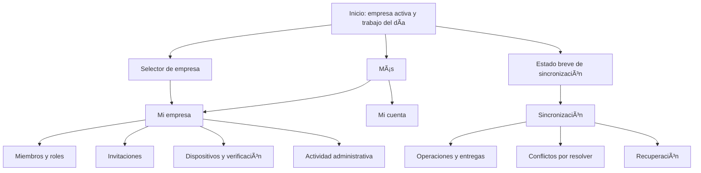

Warning: truncated output (original token count: 13952)
Total output lines: 474

# Plan-informe: organizaciones, socios y sincronización segura

**Fecha:** 7 de octubre de 2026

**Estado:** implementación en curso. La primera entrega local agrega identidad global, organizaciones y cambio seguro de contexto. Requiere migración y despliegue antes de estar disponible en VPS.
**Base:** informe de despliegue de la API del 7 de octubre, revisión del código en `server/layer` y cliente Flutter.

## Estado de avance

| Entrega | Estado local | Pendiente para uso real |
|---|---|---|
| Seguridad de autenticación | Límites persistentes, auditoría y verificación de sesión implementados | Desplegar migraciones `003` y `004` y verificar en VPS |
| Identidad global | Migración `005` consolida cuentas por correo y conserva membresías existentes | Revisar duplicados de correo y aplicar con backup |
| Organizaciones | API lista, crea, consulta y actualiza organizaciones; Flutter permite listar, crear, editar y cambiar entre ellas | Desplegar backend, migración `005` y probar con cuentas controladas |
| Miembros e invitaciones | Diseño y contratos documentados | Desarrollar endpoints y flujo de código de un solo uso |
| Dispositivos | Sesión ligada a dispositivo | Solicitud, aprobación, listado y revocación |
| Sincronización de negocio | Login, pull e inbox cifrado | Outbox cifrado, entrega entre dos clientes, descifrado y aplicación idempotente |

La migración `005_global_user_identities.sql` aborta de forma intencional si encuentra un mismo correo asociado a hashes de contraseña diferentes. En ese caso se requiere resolver la identidad manualmente antes de aplicarla; no se fusionan contraseñas de forma silenciosa.

## 1. Resumen ejecutivo

La infraestructura de transporte está desplegada: Nginx Proxy Manager publica la API HTTPS, NestJS está conectado a PostgreSQL y NATS JetStream, y la app se conecta a la API sin recibir credenciales NATS. La API tiene autenticación básica, sesiones y endpoints `sync/push` y `sync/pull`. La revisión del despliegue encontró cero organizaciones y usuarios; por ahora no se puede iniciar sesión sin crear el primer `owner` con `bootstrap-admin.ts`.

La primera entrega de administración de organizaciones ya está implementada localmente: una identidad de correo puede tener membresías en varias empresas; la persona puede listar, crear, editar y cambiar de organización desde Flutter. El cambio revoca la sesión anterior y emite otra vinculada a la membresía destino. Esta versión no está desplegada y requiere ejecutar la migración `005` antes de iniciar la API nueva.

Todavía faltan el alta autogestionada de cuentas, invitaciones de socios, administración de otros miembros y dispositivos, intercambio de claves, publicación automática del outbox Flutter y aplicación idempotente de operaciones recibidas a las tablas de negocio. El inbox actual conserva sobres cifrados y cursores, pero eso no significa que los registros empresariales ya se repliquen.

**Recomendación:** conservar un **monolito modular NestJS** para el plano de control, PostgreSQL para identidades y permisos, y NATS JetStream como buzón de transporte cifrado. En Flutter, mantener el patrón local-first con repositorios, servicios y vistas-modelo. No separar microservicios ni retirar PostgreSQL durante esta fase: eso aumentaría la operación y no resolvería la ausencia de flujos de producto.

## 2. Estado observado y límites

| Área | Ya existe | Pendiente antes del uso real |
|---|---|---|
| Despliegue | API HTTPS, NPM, PostgreSQL y NATS; health y readiness correctos | Vigilar backups, cuotas, renovación de secretos y restauración probada |
| Identidad | En VPS: login por `workspaceSlug`/email/contraseña, refresh, logout, `/auth/me`, Argon2id. En local: límites de login, validación de sesión, auditoría y cambio de organización | Desplegar/verificar cambios y migraciones; alta de cuenta, correo verificado y recuperación |
| Organización | Local: identidad global y API para listar/crear/consultar/actualizar organizaciones; Flutter para listar/crear/editar/cambiar | Aplicar migración `005` y desplegar; luego membresías e invitaciones |
| Sesiones/dispositivos | Sesión ligada a `device_id`; refresh hash en DB | Registro y aprobación de dispositivo, lista, revocación efectiva y expiración de permisos antiguos |
| Transporte sync | `push`/`pull` autenticados; relay JetStream; deduplicación de publicación | Pull segmentado por destinatario, ack de aplicación, aislamiento de buzones y backpressure |
| Flutter | Login, refresh, logout, pull, inbox/cursor Drift y envío de sobre ya cifrado | Generar/custodiar claves, cifrar outbox, publicar automáticamente, descifrar y aplicar cambios |
| Operación de datos | JetStream persistente con límites globales | Cuotas por organización, monitorización de disco, backups y política probada de recuperación |

La API actual usa una identidad runtime NATS compartida y un stream compartido; el pull explora hasta 2.000 secuencias por llamada y filtra por workspace en el servidor. Es aceptable para integración/piloto acotado, no como estrategia de escalado de múltiples organizaciones.

Hay documentación anterior que todavía describe la API como no desplegada. Para el estado operativo prevalece el informe del 7 de octubre de 2026; al iniciar cada fase se debe corregir la documentación contradictoria y enlazar las evidencias de VPS sin registrar secretos.

## 3. Arquitectura objetivo y patrones

### 3.1 Plano de control y plano de datos

```text
Flutter (DB local + claves) --HTTPS/JWT--> API NestJS --TLS/runtime--> NATS JetStream
             |                              |                                |
             | operaciones cifradas         | PostgreSQL                     | buzones cifrados
             | y aplicación local            | cuentas, organizaciones,      | retención limitada
             |                              | membresías, dispositivos      |
```

- **Plano de control (NestJS + PostgreSQL):** crea organizaciones, autentica cuentas, gestiona membresías, invitaciones, claves públicas, dispositivos, autorizaciones y auditoría. Nunca guarda claves privadas ni datos de negocio en claro.
- **Plano de datos (JetStream):** almacena y reenvía sobres opacos cifrados. No es la fuente de verdad para permisos, roles o saldos empresariales.
- **Cliente local-first (Flutter + Drift):** cada dispositivo mantiene su base local y un journal de operaciones. La API no reemplaza la base local.
- **TLS y cifrado E2E tienen propósitos distintos:** TLS protege cada enlace; el cifrado de extremo a extremo impide que el VPS lea el contenido del sobre.

### 3.2 Patrones propuestos

1. **Monolito modular / bounded contexts:** separar `identity`, `organizations`, `memberships`, `invitations`, `devices`, `authorization`, `sync` y `audit` como módulos NestJS con interfaces explícitas. Desplegarlos juntos mientras la escala sea pequeña. Evitar microservicios prematuros.
2. **Clean Architecture ligera / puertos y adaptadores:** controllers traducen HTTP; casos de uso expresan acciones; repositorios esconden PostgreSQL; `NatsMailboxPort` es un adaptador de transporte. Facilita probar los casos de uso sin VPS y cambiar límites sin dispersar lógica en controladores.
3. **Autorización RBAC + relaciones:** roles definen las capacidades generales (`owner`, `admin`, `member`); membresía aceptada, workspace, dispositivo aprobado y relación de socio determinan el acceso concreto. Denegar por defecto y verificar en el servidor en cada endpoint.
4. **Invitaciones como credenciales de un solo uso:** token aleatorio de alta entropía, asociado a workspace y rol mínimo, almacenando solo su hash, con expiración, revocación y consumo atómico. Un código no es la contraseña de la organización ni una credencial permanente.
5. **Outbox local + inbox idempotente:** persistir el cambio de negocio y su operación en una misma transacción Drift; reintentar la publicación hasta obtener confirmación del broker. En el receptor, persistir primero el sobre y el cursor; aplicar una vez lógica con `operationId` estable y conservar conflictos recuperables.
6. **Puertos/adaptadores para transporte:** `SyncTransport` abstrae HTTPS/NATS y habilita un transporte directo futuro sin cambiar el formato de operaciones. P2P directo queda fuera del MVP y no es requerido para que el buzón funcione.
7. **Políticas testeables:** mantener las reglas de autorización en servicios/casos de uso y probar la matriz usuario-rol-acción-organización-dispositivo. No depender solo de ocultar botones en Flutter.

Las recomendaciones de Flutter apoyan separar UI y datos y usar repositorios y servicios; OWASP recomienda mínimo privilegio, denegación por defecto y verificar permisos en cada petición. NestJS ofrece guards y módulos para estructurar autenticación/autorización y limitación de tasa. JetStream proporciona consumers durables con ACK explícito; la aplicación debe asumir reentrega y ser idempotente.

### 3.3 Identidad y pertenencia

Para cumplir el objetivo de no crear credenciales duplicadas al colaborar con varias empresas, se recomienda evolucionar gradualmente de `users.workspace_id` a:

- `users`: identidad global única por email normalizado, contraseña hash, estado y verificación.
- `workspaces`: organización y estado.
- `workspace_memberships`: vínculo user-workspace con rol/estado, fechas y restricciones únicas.
- `user_sessions`: sesión vinculada a usuario, workspace activo y dispositivo; el servidor valida que la membresía siga activa.

Esto exige migración y cambio de login. La app puede autenticar email/contraseña y luego seleccionar una organización; alternativamente, usar slug/código de organización como contexto de login. No se debe conservar simultáneamente dos modelos de identidad ambiguos. Antes de migrar, respaldar datos y probar la transición sin usuarios productivos (el informe indica que aún no hay ninguno).

## 4. Flujos funcionales esperados

### 4.1 Crear organización y cuenta inicial

1. Persona ingresa nombre de organización, email, contraseña y nombre visible.
2. API normaliza y valida email, verifica política de contraseña, limita intentos y crea identidad, workspace, membresía `owner` y registro de auditoría en una transacción.
3. Envía verificación de correo mediante proveedor configurado; la organización queda en estado `pending_verification` hasta completar el flujo.
4. Tras verificar, habilita login y crea sesión del dispositivo. El slug es un localizador, nunca un secreto.
5. Conserva `bootstrap-admin.ts` como recuperación operativa controlada, con auditoría y sin uso cotidiano.

No abrir alta pública hasta que haya verificación de correo, rate limiting y alertas de abuso. Para el piloto cerrado se puede crear el primer owner manualmente y usar el mismo flujo de gestión posterior.

### 4.2 Invitar y aceptar socios

1. Owner/admin genera invitación a email y rol permitido; API genera token aleatorio de un solo uso, guarda hash, workspace, creador, expiración y límites de uso.
2. Flutter comparte enlace o código; la invitación no entrega acceso ni secretos NATS.
3. Invitado se autentica/crea identidad, verifica email y acepta. La API consume la invitación una sola vez y crea membership `pending` o `active` según la política acordada.
4. Los socios confirman la asociación; sólo `accepted` autoriza lectura/escritura de datos. Rechazo, expiración o revocación invalidan el token.
5. El servidor audita creador, aceptante, tiempos, cambios de rol y revocaciones, sin registrar el token completo.

### 4.3 Aprobar y revocar dispositivos

Cada instalación crea un `deviceId` estable y claves propias. Un dispositivo nuevo inicia `pending`, muestra nombre, plataforma y huella/QR para aprobación independiente. Owner/admin puede aprobar, bloquear o revocar. La API invalida sesiones y permisos futuros; Flutter detiene el transporte y marca la clave como revocada. Revocar no puede borrar sobres ya descifrados por un dispositivo ni retirar una copia offline; la UI debe explicarlo.

### 4.4 Sincronizar un cambio de negocio

1. La acción local escribe dominio + operación versionada en una sola transacción Drift.
2. `SyncEngine` selecciona operaciones pendientes y verifica membresía, destinatarios y época de claves.
3. Flutter serializa payload canónico, cifra y firma con claves del dispositivo; el API valida tamaño, versión y claims sin descifrar.
4. NATS persiste el sobre; API confirma `accepted` sólo tras el ack de publicación.
5. Dispositivo destino descarga por su cursor/consumer, persiste inbox y cursor, valida firma y contexto, descifra y aplica en transacción local.
6. `operationId` evita duplicados. Operaciones incompatibles generan conflicto visible, no sobrescritura por hora del teléfono ni orden de llegada.
7. Un recibo firmado distingue `received` de `applied`; el emisor conserva su operación hasta que el contrato de entrega esté satisfecho.

Para dinero, compras e inventario no usar “last write wins”. Definir comandos/agregados e invariantes; por ejemplo, movimientos de stock inmutables y ajustes compensatorios, y mostrar conflictos de disponibilidad offline.

## 5. Contrato inicial de autorización

| Acción | Owner | Admin | Member |
|---|---:|---:|---:|
| Cambiar organización y transferir propiedad | Sí | No | No |
| Invitar, cambiar rol y revocar membresías | Sí | Limitado | No |
| Aprobar/revocar dispositivos | Sí | Sí (propuesta) | Sólo sus propios dispositivos |
| Ver y operar datos empresariales | Sí | Sí | Según permisos de producto |
| Generar/revocar invitación | Sí | Sí | No (MVP) |
| Administrar claves de recuperación | Sí con confirmación | No | Sus dispositivos |

La matriz es una propuesta inicial: codificarla como políticas y pruebas antes de exponer endpoints. Las acciones sensibles requieren reautenticación; cambios de propiedad, eliminación de organización y exportación de claves no deben quedar implícitos en el rol `admin`.

## 6. Fases de desarrollo y criterios de salida

### Fase 0 — Congelar contrato y entorno de piloto

- Corregir documentación obsoleta del estado de despliegue.
- Crear workspace y owner de prueba mediante bootstrap; validar login, refresh, logout y `/auth/me` contra dominio público desde Android/Web.
- Confirmar CORS, vencimientos de token, revocación de sesión, readiness y que ningún secreto NATS llega al bundle Flutter.
- **Salida:** pruebas HTTP documentadas, cuenta de prueba revocable y rollback conocido.

### Fase 1 — Seguridad base de identidad

- Añadir throttling a nivel global y más estricto para login, refresh, verificación e invitaciones; limitar login por combinación de email normalizado + IP y también por IP, con almacenamiento que resista reinicios y sin bloquear globalmente la cuenta por intentos de terceros.
- Respuestas de login y recuperación evitan enumeración; revisar política de contraseña, Argon2id, secretos JWT y logs sin tokens ni datos sensibles.
- El guard consulta y aplica revocación de sesiones/dispositivos en cada acción protegida o mediante caché con frescura documentada.
- Añadir eventos de auditoría para login fallido, éxito, sesión, cambio de rol, invitación, aprobación/revocación, push/pull y conflictos.
- **Salida:** pruebas de fuerza bruta, sesiones revocadas, concurrencia de refresh, autorización cruzada deneg…5952 tokens truncated…acta y acciones táctiles; confirmar el origen CORS no cambia el contenido visible de la seguridad.
- **Animación:** reutilizar `AppMotion`; transiciones breves para selección/expansión, progreso para operaciones reales y sin animar estados de error repetidamente. Respetar “reducir movimiento” y evitar que color/movimiento sean la única señal.
- **Accesibilidad:** soporte de lector de pantalla, labels completos, contraste AA, foco teclado, escalado hasta 200 %, targets de 48 dp y orden lógico. Verificar también textos largos traducibles y formatos locales de fecha/hora.

### 11.7 Componentes reutilizables a añadir

Colocar componentes de dominio compartidos bajo `apps/client/lib/features/organization/widgets/` y `features/sync/widgets/`, no dentro de pantallas específicas:

- `OrganizationSummaryCard`, `WorkspaceSwitcher`, `RoleBadge`, `MembershipStatusChip`.
- `MemberListTile`, `InvitationCard`, `InviteCodePanel`, `InvitationExpiryLabel`.
- `DeviceCard`, `DeviceTrustBadge`, `FingerprintComparePanel`, `RevokeDeviceDialog`.
- `SyncStageIndicator` (local/enviado/recibido/aplicado), `SyncQueueSummary`, `LastSyncLabel`.
- `ConflictSummaryCard`, `ConflictFieldComparison`, `ConflictResolutionSheet`.
- `SecurityNotice`, `PermissionGate`, `EmptyStatePanel`, `InlineRetryState`.

Todos reciben estado/acciones como parámetros o desde un view-model y no hacen llamadas HTTP/NATS por su cuenta. Los botones y cards usan `Theme.of(context).colorScheme`; los textos y tooltips se definen una vez por módulo. Mantener el acceso a datos en repositorios y la lógica de pantalla en view-model/controlador para que el patrón de presentación coincida con la arquitectura de Flutter.

### 11.8 Entregables visuales y revisión antes de cerrar cada fase

1. Actualizar sitemap/wireframes en `docs/ux_v2.md` para incluir onboarding, administración de organización, invitaciones, dispositivos, claves y conflictos; marcar qué existe, es placeholder o queda futuro.
2. Definir tabla de rutas, permisos y CTA por vista junto con casos de loading/empty/error/offline.
3. Implementar tokens compartidos y componentes; no crear una paleta paralela.
4. Crear widget tests de permisos/acciones críticas y layouts; comprobar textos grandes, pantalla estrecha, teclado y modo Web.
5. Revisar capturas de Android pequeño, Android grande y Web de escritorio; validar que los estados representen las respuestas reales del API.
6. Comprobar semántica/contraste y navegación con teclado/lector antes del lanzamiento.

**Criterio visual de terminado:** una persona puede crear/seleccionar empresa, comprender su rol, invitar y aceptar a un socio, reconocer dispositivos confiables, revocar acceso y diagnosticar por qué una operación no se aplicó sin leer IDs técnicos ni confundir “conectado” con “sincronizado”.

### 11.9 Experiencia completa de consumo y administración

**Objetivo de esta revisión:** que una persona pueda operar su negocio, administrar quién participa y entender el estado de sus datos desde la misma aplicación. El área administrativa debe mostrar tareas accionables y su resultado, además de formularios de configuración.



**Cabecera compartida:** nombre de la empresa activa, rol con etiqueta legible (Propietario/Administrador/Miembro), acceso al selector, indicador resumido de sincronización y acceso a cuenta. En móvil priorizar empresa y estado; las acciones secundarias se despliegan en un menú. Conservar los destinos principales del negocio de la barra inferior para no desplazar Obras, Mantenimientos o Finanzas.

**Inicio de Mi empresa para owner/admin:** resumen de miembros activos y dispositivos aprobados, bandeja de solicitudes pendientes, invitaciones próximas a vencer y actividad reciente. CTA principal “Invitar miembro”; cada solicitud lleva a una vista de detalle antes de autorizar. Un contador desconocido se muestra como “Sin actualizar”, nunca como cero. No afirmar que un dispositivo está online sólo por tener una sesión vigente: mostrar “Último contacto” con fecha.

**Inicio de Mi empresa para member:** nombre de organización, rol y permisos, responsable de contacto, estado de sus dispositivos e invitaciones que pueda aceptar. La UI deriva acciones del permiso efectivo; pertenecer a la empresa no da acceso a la gestión de todos los dispositivos. El servidor vuelve a comprobar cada acción.

**Composición de escritorio:** navegación lateral existente, cabecera con empresa, lista principal y panel de detalle; filtros y paginación accesibles por teclado. Usar la misma selección/estado que móvil. Abrir una fila muestra detalle; aprobar/revocar es una acción explícita y separada de seleccionar.

Wireframe orientativo de Mi empresa (los números sólo ilustran distribución; la implementación usa datos reales):

```text
Mi empresa · Decolumax                  Propietario   [Cambiar empresa]
Resumen  |  Miembros  |  Invitaciones  |  Dispositivos  |  Actividad

Miembros activos     Dispositivos aprobados     Solicitudes pendientes
        3                       4                         1

Requiere tu atención                                   [Invitar miembro]
Nuevo dispositivo · Android · Carlos              [Revisar solicitud]
Invitación pendiente · Ana · vence mañana             [Ver invitación]

Actividad reciente
Carlos aceptó la invitación                              Hoy, 10:15
Este dispositivo terminó de recibir cambios              Hoy, 10:10
```

Los eventos de sincronización sólo aparecen en actividad si existe evidencia de entrega para ese dispositivo y el usuario tiene permiso. El wireframe no prueba que esas métricas estén disponibles en la API actual.

### 11.10 Correspondencia entre vistas y API

Las rutas de alta/administración de esta tabla son **contratos propuestos pendientes**. Los endpoints existentes de autenticación y sync se conservan o versionan al migrar identidad; no se muestra éxito simulado en pantallas sin backend.

| Intención del usuario | Consumo de API | Resultado visible y control necesario |
|---|---|---|
| Entrar y recuperar sesión | Login, refresh y `/auth/me` existentes; adaptar a identidad global | Organización, rol y capacidades efectivos. El login deja de estar incrustado en una tarjeta de diagnóstico. |
| Ver mis empresas / cambiar | Listado autorizado de organizaciones y selección de contexto, por implementar | Cabecera y consultas cambian juntas; mostrar progreso mientras se prepara el contexto local. |
| Crear empresa | Alta de identidad si hace falta, creación de organización y membership, por implementar | Resumen de la empresa creada y pasos pendientes. Si la persona ya tiene cuenta, no pedir otra contraseña ni crear otra identidad. |
| Administrar miembros | Listar/detallar membership, cambiar rol y revocar, por implementar | Lista actualizada tras confirmación del servidor. Impedir quitar/degradar al último owner; transferencia de propiedad requiere flujo dedicado. |
| Invitar / aceptar | Emitir, consultar estado, cancelar y consumir invitación, por implementar | Token sólo al emitir; expiración, estado y rol comprensibles. Doble tap/reintento no crea membresías duplicadas. |
| Aprobar dispositivo | Solicitud, prueba de posesión, detalle y aprobación/revocación, por implementar | Huella y propietario antes de aprobar; el estado confiable exige completar verificación e intercambio de claves. |
| Sincronizar | `push`/`pull` existentes más motor E2E, procesamiento local y recibos pendientes | Progreso por etapa. “Aplicado” requiere confirmación local o recibo del destino identificado. |
| Ver disponibilidad | `/health` y `/health/ready`, sesión y estado del motor | Disponibilidad HTTPS separada de permisos, claves y entrega. Retirar el sondeo TCP/TLS directo a NATS del flujo habitual de la app. |
| Resolver conflicto | Caso de uso local que genera una operación de resolución | Conserva las versiones comparadas y muestra cuándo la resolución llegó a otros dispositivos. |
| Revisar actividad | Consulta paginada autorizada, por implementar | Actor, acción, resultado y fecha, sin secretos. Filtros por miembro, dispositivo y periodo. |

Cada módulo expone intents concretos como `createOrganization`, `acceptInvitation`, `changeRole`, `approveDevice` y `retrySync`. View-models coordinan repositorios y publican estados; widgets reciben callbacks. Evitar un controlador global que contenga todas las reglas de empresa, criptografía y navegación.

### 11.11 Comportamientos que completan la experiencia

- **Cambio seguro de empresa:** detener tareas del contexto saliente, invalidar respuestas HTTP atrasadas y cargar repositorios/cursores/claves del destino. La cola pendiente de la empresa anterior se conserva con su workspace; nunca se renombra ni se envía a la empresa seleccionada. Los registros locales anteriores a la asociación requieren una migración/importación explícita, no una reasignación automática al hacer login.
- **Modo offline:** permitir las operaciones de negocio soportadas por el dominio local. Crear membresías, aprobar dispositivos y cambiar roles requieren respuesta del servidor; mostrar el motivo y conservar borradores, sin presentar aprobaciones pendientes como permisos efectivos.
- **Sesión vencida:** ofrecer reautenticación conservando cambios locales. Logout revoca/borra tokens según el flujo, pero no ejecuta un borrado silencioso de la base empresarial. El borrado local es otra acción explícita con sus consecuencias.
- **Paginación y consumo:** listas paginadas, búsqueda con debounce, una carga activa por intención y límite de concurrencia del motor. Actualizar al abrir, volver al primer plano, completar una mutación o usar “Actualizar”; el polling continuo por cada pantalla no es necesario. Cancelar las cargas al salir de la vista cuando proceda.
- **Caché autorizada:** indexar datos administrativos por usuario y workspace; mostrar la fecha de actualización. Una respuesta nueva de revocación/403 invalida las acciones y cachés correspondientes. Los permisos cacheados sirven para presentación, no para conceder acceso nuevo.
- **Errores recuperables:** asociar 401 a renovación/relogin, 403 a permiso insuficiente, 409 al conflicto de estado específico devuelto por la API, 429 a espera indicada por el servidor y fallos de red a reintento. Validaciones aparecen junto al campo; el estado global se anuncia con banner. No borrar un formulario por error de red.
- **Resultado incierto:** tras timeout de una acción sensible, consultar su resultado con la misma identidad de operación antes de ofrecer repetirla. Evitar generar varias invitaciones o duplicar organizaciones por doble tap.
- **Invitación desde enlace:** conservar intención durante login y verificación, volver al resumen de la empresa invitante y aceptar sólo tras confirmación explícita. Ofrecer entrada manual de código cuando no exista cámara o el enlace no abra la app; quitar el secreto de la URL después de capturarlo y no enviarlo a analítica.
- **Permisos por tarea:** controles de administración visibles sólo para quien tiene la acción; acciones que dependen de red o verificación muestran motivo de indisponibilidad. La UI no debe ocultar que falta aprobar un dispositivo ni confundirlo con un fallo de contraseña.
- **Privacidad de diagnósticos:** dominio HTTPS/configuración técnica se limita a detalles de soporte. No solicitar al usuario host NATS, stream, consumidor ni credenciales runtime. La pantalla normal habla de empresa, registros, dispositivos y entregas.

### 11.12 Secuencia de entrega visual y funcional

| Entrega | Alcance vertical (vista + lógica + API) | Demostración de cierre |
|---|---|---|
| UI-1 | Shell con empresa activa, acceso independiente y estado HTTPS real | Login existente funciona; el usuario distingue sesión de sincronización y puede abrir Cuenta/Mi empresa/Sync. |
| UI-2 | Crear/seleccionar organización y administrar perfil | Alta real y cambio de empresa sin mezcla de datos; migración de identidad cubierta. |
| UI-3 | Miembros, invitaciones y aceptación con permisos | Dos cuentas completan invitación y aceptación; token repetido/expirado y último owner están controlados. |
| UI-4 | Dispositivos, QR/huella, aprobación y revocación | Segundo dispositivo se autoriza y obtiene acceso según el protocolo; dispositivo revocado pierde acceso futuro. |
| UI-5 | Estado de operaciones, detalle de entrega y conflictos | Una operación real viaja cifrada y se aplica una vez; un conflicto real puede revisarse y resolverse. |
| UI-6 | Actividad, recuperación y revisión visual de release | Flujo completo móvil/Web con teclado, texto grande, offline, errores, restauración y capturas verificadas. |

La secuencia visual se ejecuta junto a las fases técnicas 0–8; crear la pantalla no cierra el módulo si no existe su caso de uso y contrato API. Primero revisar una composición móvil y otra Web con datos de prueba claramente identificados; después conectar las acciones y validar con cuentas reales del piloto.

## 12. Referencias técnicas consultadas

- NestJS, autenticación y limitación de intentos: [Authentication](https://docs.nestjs.com/security/authentication), [Rate Limiting](https://docs.nestjs.com/security/rate-limiting), [Authorization](https://docs.nestjs.com/security/authorization).
- Flutter, separación UI/datos y repositorios: [Architecture recommendations](https://docs.flutter.dev/app-architecture/recommendations), [Guide to app architecture](https://docs.flutter.dev/app-architecture/guide).
- NATS, persistencia, consumers durables y ACK: [JetStream concepts](https://docs.nats.io/concepts/jetstream), [JetStream deep dive](https://docs.nats.io/learn/jetstream/).
- OWASP, autorización y multi-tenancy: [Authorization Cheat Sheet](https://cheatsheetseries.owasp.org/cheatsheets/Authorization_Cheat_Sheet.html), [Multi-Tenant Security Cheat Sheet](https://cheatsheetseries.owasp.org/cheatsheets/Multi_Tenant_Security_Cheat_Sheet.html), [Forgot Password Cheat Sheet](https://cheatsheetseries.owasp.org/cheatsheets/Forgot_Password_Cheat_Sheet.html).
- Criptografía móvil: [Android Keystore](https://developer.android.com/privacy-and-security/keystore), [Libsodium authenticated encryption](https://doc.libsodium.org/public-key_cryptography/authenticated_encryption). Estas referencias orientan requisitos; no seleccionan automáticamente el protocolo E2E final.
- Mensajería fiable: [Transactional Outbox pattern](https://learn.microsoft.com/en-us/azure/architecture/databases/guide/transactional-out-box-cosmos).
- Documentos de producto que complementan este informe: [`migracion-sync-cifrado.md`](migracion-sync-cifrado.md), [`sync-api.md`](sync-api.md), [`../../../docs/sync_protocol_v3.md`](../../../docs/sync_protocol_v3.md).

